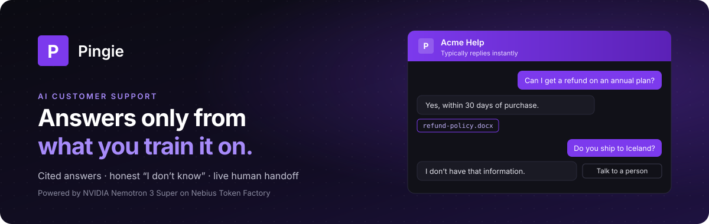
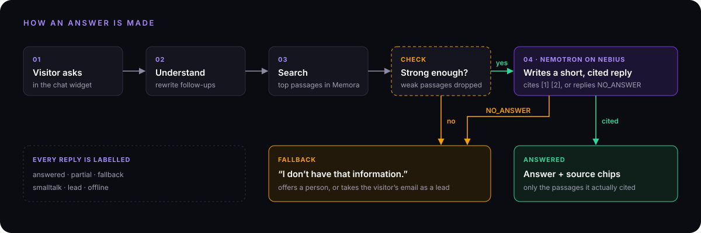
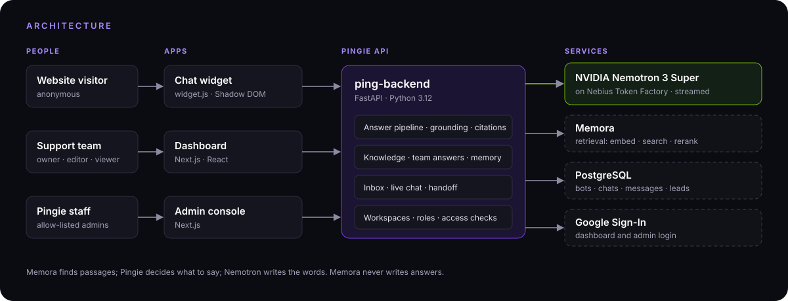

<p align="center">
  
</p>

<div align="center">


[Live app](#) · [Demo video](#) · [Handbook (PDF)](#)

</div>

> [!TIP]
> **Hackathon build:** every answer in Pingie is written by **NVIDIA Nemotron 3 Super** running on **Nebius Token Factory**. See [Built with NVIDIA Nemotron on Nebius](#-built-with-nvidia-nemotron-on-nebius).

---

## Contents

1. [Pingie in one chat](#-pingie-in-one-chat)
2. [The problem](#-the-problem)
3. [Our solution](#-our-solution)
4. [Why it's different](#-why-its-different)
5. [Features](#-features)
6. [How an answer is made](#-how-an-answer-is-made)
7. [Architecture](#-architecture)
8. [How to use Pingie (for a business)](#-how-to-use-pingie-for-a-business)
9. [Add Pingie to your website](#-add-pingie-to-your-website)
10. [Run it locally](#-run-it-locally)
11. [Configuration](#-configuration)
12. [Built with NVIDIA Nemotron on Nebius](#-built-with-nvidia-nemotron-on-nebius)
13. [Testing](#-testing)
14. [Repository](#-repository)
15. [License](#-license)

---

## 💬 Pingie in one chat

> **Visitor:** Can I get a refund on an annual plan?<br/>
> **Pingie:** Yes. Annual plans can be refunded within 30 days of purchase. 📄 `refund-policy.docx`
>
> **Visitor:** Do you ship to Iceland?<br/>
> **Pingie:** I don't have that information. Leave your email and the team will follow up. `[Talk to a person]`

The first answer comes straight from the business's own document and shows its source. The second question isn't covered, so Pingie says so honestly and offers a person instead of guessing.

---

## ❓ The problem

Every business with a website gets the same questions again and again: prices, refunds, delivery, how to set something up. Today they handle them in one of two ways, and both fall short.

| | What happens | Why it hurts |
|---|---|---|
| 📧 **Email or contact forms** | Visitors wait hours, sometimes days, for a reply. | Customers leave before they get an answer. |
| 🔁 **The support team** | People answer the same questions all day. | Slow, expensive, and hard to scale. |
| 🤖 **Generic AI chatbots** | They answer from general internet knowledge. | They invent prices and policies, and customers lose trust. |
| 🕳️ **Unanswered questions** | Questions the bot can't handle just disappear. | Lost sales, and nobody learns what is missing. |

Small teams need something that answers **instantly**, stays **accurate**, and knows when to **hand over to a person**.

---

## ✅ Our solution

Pingie is an AI support assistant that a business adds to its website with **one script tag**.

1. **Train it** with your own files and the answers your team writes.
2. **It answers visitors** in seconds, only from that material, with the source shown under every reply.
3. **When it doesn't know**, it says so, and offers a live person or takes the visitor's email.
4. **Your team sees every chat** in one dashboard, can take over any conversation, and can turn any missed question into a new answer.

Every unanswered question becomes a **lead**, a **live handoff**, or a **knowledge gap** on the dashboard, so the bot keeps getting better.

---

## ⭐ Why it's different

| | Typical chatbot | Pingie |
|---|---|---|
| Knowledge | General internet knowledge | Only your files and team answers |
| Proof | No sources | Source chip on every answer |
| Unknown question | Guesses | Says "I don't know" and captures the lead |
| Human help | A separate tool | Live handoff in the same widget |
| Learning | Re-train or re-prompt | Write the right answer once; it is reused word for word |

---

## 🧩 Features

**For website visitors**
- Answers stream word by word within seconds, around the clock.
- A source chip under every answer shows where it came from.
- Up to 4 suggested questions to get started.
- **Talk to a person** when a teammate is online, or leave an email when nobody is.
- Replies in English, Hindi or Tamil, or automatically in the visitor's language.
- The chat is remembered across page loads.

**For the support team**
- **Conversations inbox** with filters (Live, Unanswered, Disliked, Handoffs), search and CSV export.
- **Live chat**: take over any chat, reply in real time, then hand it back to the bot.
- **Train the bot**: write the right answer under any missed or disliked reply. It is reused word for word next time.
- **Chat memory**: finished chats your team answered are added to the bot's knowledge, with emails and phone numbers removed.
- **Overview analytics**: conversations, resolution rate, first response time, handoffs, top questions and knowledge gaps.

**For the business**
- **Knowledge**: upload PDF, DOCX, TXT, MD or CSV files (up to 25 MB each) and write team answers.
- **Appearance**: title, welcome message, accent colour, light or dark theme, launcher icon and position, with a live preview.
- **Answer settings**: tone (friendly, professional or concise), reply language, strictness (strict, balanced or helpful), model tier and fallback message.
- **Stays on topic**: questions unrelated to the business get a polite redirect.
- **Teams**: workspaces with owner, editor and viewer roles, invitations, and sharing a single bot.
- **Allowed domains**: the widget only loads on the sites you list.

---

## 🧠 How an answer is made

<p align="center">
  
</p>

- **Grounded:** weak passages are dropped before the model sees them, and the model is told to use nothing else.
- **Cited:** only the passages the answer actually uses become source chips.
- **Honest:** if the sources don't cover the question, the model must reply `NO_ANSWER` and the visitor sees the fallback.
- **Labelled:** every reply is tagged `answered`, `partial`, `fallback`, `smalltalk`, `lead` or `offline`, so gaps show up on the dashboard.

---

## 🏗️ Architecture

<p align="center">
  
</p>

| Part | Job |
|---|---|
| **Chat widget** | One small script in a Shadow DOM, so the host site's styles never clash with it. |
| **Dashboard** | Where the support team trains the bot, reads chats and replies live. |
| **ping-backend** | Sign-in, workspaces, bots, knowledge, the answer pipeline, inbox and live chat. |
| **Memora** | Finds the most relevant passages in the bot's knowledge. It never writes answers. |
| **Nemotron on Nebius** | Writes each answer from the passages Pingie gives it. |
| **PostgreSQL** | Stores bots, chats, messages, leads and live-chat state. |

---

## 🚀 How to use Pingie (for a business)

1. **Sign in** with Google. A personal workspace is created for you.
2. **Create a bot.** Give it a name and your website address. The site is added as an allowed domain.
3. **Add knowledge.** On **Knowledge**, upload your help documents and policies, or write team answers.
4. **Test it.** On **Test**, ask a question and see the passages found, their scores and the answer, without saving anything.
5. **Customise it.** On **Settings**, set the tone, language, strictness and fallback message. On **Appearance**, match your brand.
6. **Install it.** Copy the snippet from **Install** into your site (see below).
7. **Go live.** Switch the bot from **Draft** to **Live**.
8. **Improve it.** Check **Conversations** for missed or disliked answers, and write the right answer once.

A bot is always in one of three states:

| State | Behaviour |
|---|---|
| **Draft** | Loads only on localhost (with **Allow localhost** on), for testing. New bots start here. |
| **Live** | Loads on your allowed domains and answers visitors. |
| **Paused** | Shows as offline and replies with the offline message. |

---

## 🌐 Add Pingie to your website

Copy your bot ID from the **Install** page, then use the snippet for your platform.

**HTML** (paste before `</body>`)

```html
<script src="https://YOUR-PINGIE-HOST/widget.js" data-bot-id="bot_xxxxxxx" defer></script>
```

**React**

```jsx
import { useEffect } from "react";

export function PingieWidget() {
  useEffect(() => {
    const s = document.createElement("script");
    s.src = "https://YOUR-PINGIE-HOST/widget.js";
    s.dataset.botId = "bot_xxxxxxx";
    s.defer = true;
    document.body.appendChild(s);
    return () => s.remove();
  }, []);
  return null;
}
```

**Next.js** (`app/layout.tsx`)

```jsx
import Script from "next/script";

<Script src="https://YOUR-PINGIE-HOST/widget.js" data-bot-id="bot_xxxxxxx" strategy="lazyOnload" />
```

**WordPress, Shopify and other site builders:** paste the HTML snippet into your theme's footer, or into any "header and footer scripts" setting.

**Script options**

| Attribute | Required | Purpose |
|---|---|---|
| `data-bot-id` | Yes | Your bot's public ID |
| `data-api` | No | The backend address, if it differs from where `widget.js` is served |
| `data-open="true"` | No | Open the chat when the page loads |

**Allowed domains:** on **Domains**, add each site the widget may run on. `help.acme.com` matches that host only; `*.acme.com` matches acme.com and every subdomain. On any other site the widget stays hidden. The **Install** page shows the last site that loaded your widget, so you can confirm it works.

**JavaScript API** (optional)

```js
Pingie.open();      Pingie.close();      Pingie.toggle();
Pingie.ask("How do refunds work?");                        // open and send a question
Pingie.identify({ email: "jane@acme.com", name: "Jane" }); // attach a known customer
Pingie.reset();     // start a new conversation
Pingie.destroy();   // remove the widget
```

Calls made before the widget loads are queued.

---

## 💻 Run it locally

**You need:** Python 3.12+, Node 20+, a PostgreSQL database (Neon works), a Memora API token, a Nebius API key and a Google OAuth client ID.

**1. Backend** (http://localhost:8080, API docs at `/docs`)

```bash
cd ping-backend
cp .env.example .env            # then fill in the values below
python3 -m venv .venv && .venv/bin/pip install -r requirements.txt
.venv/bin/alembic upgrade head
.venv/bin/uvicorn app.main:app --reload --port 8080
```

**2. Widget** (built and served by the backend at `/widget.js`)

```bash
cd ping-widget
npm install
npm run build:backend
```

**3. Dashboard** (http://localhost:3000)

```bash
cd ping-frontend
echo "NEXT_PUBLIC_GOOGLE_CLIENT_ID=<your-client-id>" > .env.local
echo "BACKEND_URL=http://localhost:8080" >> .env.local
npm install
npm run dev
```

In Google Cloud Console, add `http://localhost:3000` as an authorised JavaScript origin of your OAuth client.

**4. Try it:** sign in → create a bot → turn on **Allow localhost** → upload a file → paste this into any local HTML page:

```html
<script src="http://localhost:8080/widget.js" data-bot-id="bot_xxxxxxx" defer></script>
```

**Optional apps**

```bash
cd ping-admin && npm install && npm run dev   # admin console, http://localhost:3001
cd ping-doc   && npm install && npm run dev   # docs and API reference, http://localhost:3003
```

---

## ⚙️ Configuration

The main settings in `ping-backend/.env`:

| Variable | Value |
|---|---|
| `DATABASE_URL` | Your PostgreSQL URL |
| `AUTH_JWT_SECRET` | Any long random string |
| `GOOGLE_CLIENT_ID` | Your Google OAuth client ID |
| `MEMORA_BASE_URL`, `MEMORA_API_TOKEN` | Your Memora server and token |
| `MODEL_PROVIDER` | `nebius` |
| `NEBIUS_API_KEY` | Your Nebius Token Factory key |
| `LLM_MODEL_BALANCED` | `nvidia/nemotron-3-super-120b-a12b` |
| `LLM_MODEL_FAST`, `LLM_MODEL_BEST` | Optional. Leave empty to use the Balanced model |
| `ADMIN_EMAILS` | Google accounts allowed into the admin console |
| `SMTP_HOST`, `SMTP_USERNAME`, `SMTP_PASSWORD` | Optional. Sends lead and invitation emails |

> 🔒 Never commit real keys. Keep them in `.env`, which stays on your machine.

---

## ⚡ Built with NVIDIA Nemotron on Nebius

Every answer is written by **NVIDIA Nemotron 3 Super (120B total, about 12B active per token)** through **Nebius Token Factory**.

| Setting | Value | Why |
|---|---|---|
| API | OpenAI-compatible `/chat/completions` | Simple integration: a base URL, a key and a model name |
| Streaming | On, with token usage | Visitors see words appear straight away |
| Temperature | 0.2 | Steady, repeatable answers |
| Max answer length | 700 tokens | Short, focused support replies |
| Thinking | Off (`enable_thinking: false`) | The whole token budget goes to the answer, and the first word arrives sooner |
| Tiers | Fast, Balanced, Best | All use Nemotron 3 Super unless set otherwise. Fast handles small jobs like rewriting follow-up questions |

Per reply, Pingie records the model, tokens, total time and time to first word.

Code: [`ping-backend/app/clients/llm.py`](ping-backend/app/clients/llm.py) · settings: [`ping-backend/app/core/config.py`](ping-backend/app/core/config.py)

---

## 🧪 Testing

```bash
cd ping-backend
.venv/bin/pip install -r requirements-dev.txt
.venv/bin/pytest -q              # unit and integration tests (integration tests need a throwaway PostgreSQL)
.venv/bin/python -m evals.runner # 35 answer-quality cases
```

The answer evaluation checks factual correctness, groundedness, citation relevance and the handling of questions that can't be answered. Add `--llm live` to run it against the real model. See [`ping-backend/evals/README.md`](ping-backend/evals/README.md).

---

## 📁 Repository

| Folder | What it is | Port |
|---|---|---|
| [`ping-backend`](ping-backend) | API, answer pipeline, live chat | 8080 |
| [`ping-frontend`](ping-frontend) | Support-team dashboard | 3000 |
| [`ping-widget`](ping-widget) | Embeddable chat widget | — |
| [`ping-admin`](ping-admin) | Internal admin console | 3001 |
| [`ping-doc`](ping-doc) | Docs and API reference | 3003 |

---

## 📄 License

Pingie is open source under the [Apache License 2.0](LICENSE). You may use, modify and distribute it, including commercially, as long as you keep the license and copyright notices.
